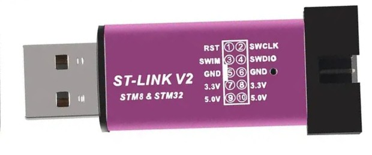

# FreeEEG128 programming and updates

## Verified target connections

The new diagram uses the supplied component-side photograph. Electrical pin
numbers come from `AssemblyFiles/KiCAD/FreeEEG128-alpha.kicad_pcb`.

| Target header | Pin | Signal | Connect to |
| --- | --- | --- | --- |
| J1, beside RESET | 1, square | PB2 / BOOT1 | Leave disconnected |
| J1 | 2 | NRST | Probe STM32 NRST / RST |
| J1 | 3 | PA14 / SWCLK | Probe SWCLK |
| J1 | 4 | PA13 / SWDIO | Probe SWDIO |
| J2, beside BOOT | 2 | GND | Probe GND |
| J2 | 4 | 5 V supply input | Normal board power; never a probe VTref input |

J2's other pins are BOOT0 and the ACC CS net; do not use them as ground.
Square pad 1 is an orientation marker, not a ground convention. Flipping the
board mirrors positions. Check continuity on the actual PCB revision.

Power the board through its normal supply and disconnect electrodes for
programming. If the probe needs VTref/VAPP, connect that input to the measured
3.3 V MCU I/O supply. Do not connect it to the 5 V input. Avoid joining the
probe's power outputs to an already powered target.

## ST-Link V2 dongles

For the printed pinout on this pictured dongle: pin 4 SWDIO → J1.4; pin 2 SWCLK
→ J1.3; pin 5 or 6 GND → J2.2. Pin 1 RST → J1.2 only if it supports STM32 NRST.
Leave SWIM and the dongle's 3.3 V / 5 V power outputs disconnected when separately
powering the board. Clone layouts vary: use the printed signals, not a generic
connector drawing. Some dongles expose only STM8 SWIM reset.

The default flashing connection is under hardware reset. If the probe lacks
working STM32 NRST and the target boots normally, use `-Connect normal` on
Windows or `--connect normal` on Linux. Recovery from code that blocks SWD needs
a working NRST connection.

## First install and later updates

Open the root FreeEEG128 launcher. Choose **4** to compile source and install the
combined factory HEX, or **3** to install a previously compiled factory HEX.
The helper verifies the write and resets the MCU. No option bytes are changed.

Later, choose **2** after source edits, then **5** for a USB application update.
The helper enters the loader, checks the target/image identity, copies the UF2
and verifies the running build. To enter manually, press RESET twice within
600 ms and copy `freeeeg128-application.uf2` to **FREEEEG128**. BOOT selects ST ROM
boot, which cannot use the PB14/PB15 data connector.

If an upload is incomplete, reset and copy the whole UF2 again. An interrupted
installation retries the verified staged image on the next boot. Keep the board
powered while an installation finishes. An invalid application leaves the board
in the loader. Reinstall the factory HEX through SWD for loader recovery.

[Flash options](../Flash/README.md) · [Loader internals](../Firmware/UF2/README.md).
